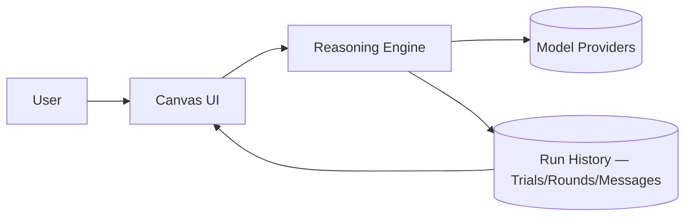

<div align="center">

# 🤖 Stochastic Agents

### A testbed for watching LLM agents self-organise toward consensus

[](https://github.com/ISDO-TUM/project_AI_agents_stochastic_self_organisation/actions)


</div>

## Table of Contents

- [What it is](#what-it-is)
- [How it works](#how-it-works)
- [Quickstart](#quickstart)
- [Project structure](#project-structure)
- [Configuration](#configuration)
- [Evaluation](#evaluation)
- [Research context](#research-context)
- [Team](#team)
- [Contributing](#contributing)

---

## What it is

> Stochastic Agents is a research platform for studying how groups of LLM-backed agents self-organise into a shared answer. Agents exchange messages over a configurable communication graph — fixed or rewired round-by-round — and their independent outputs are reduced to an outcome through a pluggable consensus mechanism, with every round, message, and decision persisted for full replay. It exists to give researchers a controllable, observable testbed for emergent multi-agent behaviour, rather than a one-off prompt-chaining demo.

A canvas UI lets you wire up agents, attach knowledge files or datasets, choose a topology and consensus mode, and watch (and replay) the run round-by-round.

---

## How it works



### Topology

Defines who talks to whom each round. **Static** topologies keep a fixed communication graph for predictable, comparable runs; **dynamic** topologies let agents declare peers and have a controller rewire the graph between rounds (with optional fan-out caps), trading predictability for emergent, self-organising structure.

### Consensus

Defines how independent agent outputs become a single outcome signal. Three modes ship today: `broadcast_no_consensus` (no reducer — preserves all outputs for analysis), `weighted_opinion_pooling` (trust-weighted integration that stabilises over rounds), and `plurality_voting` (normalised vote tally with an explicit winner and rationale).

### Persistence & replay

Every run is a `Trial`, broken down into `Rounds` → `Connections` → `Messages`, written to Postgres as it happens. Nothing lives only in UI memory — replay, inspection, and benchmarking all read from the same persisted trace.

→ See [docs/architecture.md](docs/architecture.md) for the full technical breakdown and [docs/data-model.md](docs/data-model.md) for the entity relationships.

---

## Quickstart

> **On Windows?** Use [WSL 2](https://learn.microsoft.com/en-us/windows/wsl/install) — native Windows is not supported. Install Node.js _inside_ WSL.

> **Prerequisites** — [Node.js 22 LTS](https://nodejs.org/) is the only thing you install manually. The setup script installs `uv`, `pnpm`, all Python/Node dependencies, and the git hooks.

```bash
git clone https://github.com/ISDO-TUM/project_AI_agents_stochastic_self_organisation.git
cd project_AI_agents_stochastic_self_organisation
./scripts/setup.sh   # installs everything
pnpm dev             # start the app (UI on :3000, API on :8000)
```

Open **[http://localhost:3000](http://localhost:3000)** — you're running. 🎉

> Hitting a snag, or want the Docker-based path instead? The [local development guide](docs/local-development.md) covers both, including troubleshooting.

---

## Project structure

```
.
├── server/               # FastAPI backend — orchestration, topology, consensus, persistence
├── client/               # Next.js canvas UI — author agents, run sims, inspect history
├── demos/                # Importable canvas configs for quick demos (see demos/README.md)
├── docs/                 # Architecture, data model, CI, and local-dev guides
├── scripts/setup.sh      # One-time setup — installs uv, pnpm, deps, git hooks
├── docker-compose.yaml   # Full-stack Docker configuration
└── CONTRIBUTING.md       # Branch/commit conventions and how we work
```

---

## Configuration

`setup.sh` creates a `.env` at the repo root, pre-seeded with `DATABASE_URL` for the bundled Postgres. Add provider keys there too:

| Variable            | Required | Default              | Description                                                       |
| ------------------- | :------: | -------------------- | ----------------------------------------------------------------- |
| `DATABASE_URL`      |    ✅    | bundled Postgres URL | PostgreSQL connection string — seeded automatically by `setup.sh` |
| `OPENAI_API_KEY`    |    ☑️    | —                    | OpenAI provider key                                               |
| `ANTHROPIC_API_KEY` |    ☑️    | —                    | Anthropic provider key                                            |
| `GROQ_API_KEY`      |    ☑️    | —                    | Groq provider key                                                 |
| `GEMINI_API_KEY`    |    ☑️    | —                    | Gemini provider key                                               |
| `LLM_PROXY_API_KEY` |    ☑️    | —                    | Single key for routing all providers through one proxy            |

> **Note** — at least one provider key is required to actually run agents against a model; tests run against an in-memory SQLite database and need none of the above.

> ⚠️ Never commit `.env` — it's gitignored by default.

### Deploying (Railway)

The server and client deploy to Railway via [`_deploy.yml`](.github/workflows/_deploy.yml). The server needs its own PostgreSQL service: add one in the Railway project, then point the server's `DATABASE_URL` at the reference variable Railway exposes for it (e.g. `${{ Postgres.DATABASE_URL }}`). The app normalises Railway's `postgresql://` URL to the asyncpg driver and creates its tables on startup — no manual migration step required.

---

## Evaluation

A majority-vote needle-in-a-haystack benchmark ships with the backend: a strict majority of agents receive a chunk containing the correct "needle," the rest get a plausible-but-wrong one, and `plurality_voting` consensus should converge on the right answer within two rounds. With the dev server running, trigger a trial via its HTTP API:

```bash
curl -X POST http://localhost:8000/benchmark/needlehaystack/create \
  -H "Content-Type: application/json" \
  -d '{"num_agents": 4, "sentences_per_agent": 6}'
```

→ See [server/benchmarks/README.md](server/benchmarks/README.md) for the full methodology, response shape, and the standalone trial runner.

---

## Research context

This project investigates how groups of LLM-backed agents can be steered toward emergent, self-organising consensus through **topology** and **consensus-mechanism** design — rather than hand-scripted orchestration. It is developed as the ISDO capstone project (Team 2, 2026) at the Technical University of Munich, in collaboration with SAP.

---

## Team

All team members are contributing developers in addition to their role inside the practical course

| Name                                              | Role                      |
| ------------------------------------------------- | ------------------------- |
| [Mohamed Nejjar](https://github.com/MoNejjar)     | Product Owner             |
| [Xavier Kamsu Nzodoum](https://github.com/Xaka68) | Scrum Master              |
| [Moritz Grüss](https://github.com/MoritzGruesome) | Research Lead             |
| [Hamza Chaouki](https://github.com/HamzaChx)      | DevOps & Infrastructure   |
| [Bryan Alvin](https://github.com/brebribre)       | Documentation             |
| [Paul Dallwig](https://github.com/pdallwig)       | Validation & Benchmarking |

---

## Contributing

Read **[CONTRIBUTING.md](CONTRIBUTING.md)** before opening a PR. Quick summary:

| What   | Convention                                                                                         |
| ------ | -------------------------------------------------------------------------------------------------- |
| Branch | `feat/42-my-feature` — always include the issue number                                             |
| Commit | `feat(api): add streaming endpoint` ([Conventional Commits](https://www.conventionalcommits.org/)) |
| Hooks  | Run automatically on `git commit` — no manual formatting needed                                    |

New here? The contributing guide is written to be quick — give it 5 minutes and you'll know everything you need.
