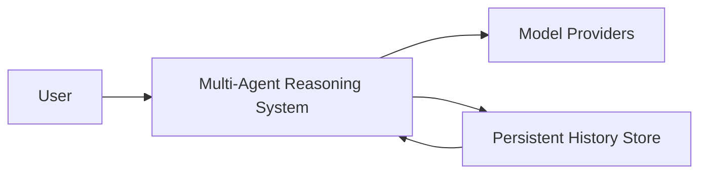
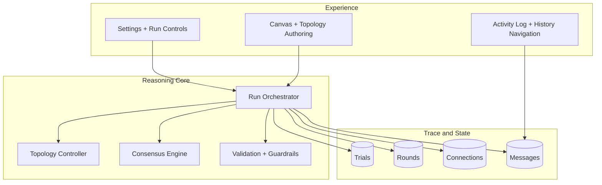
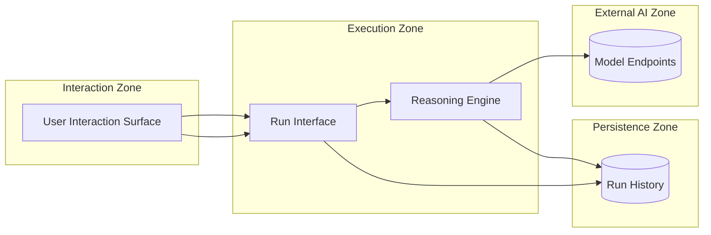
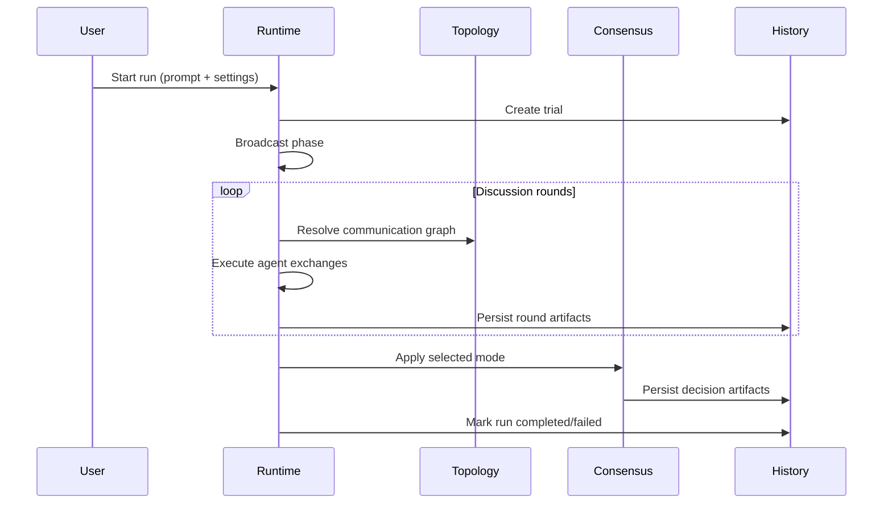
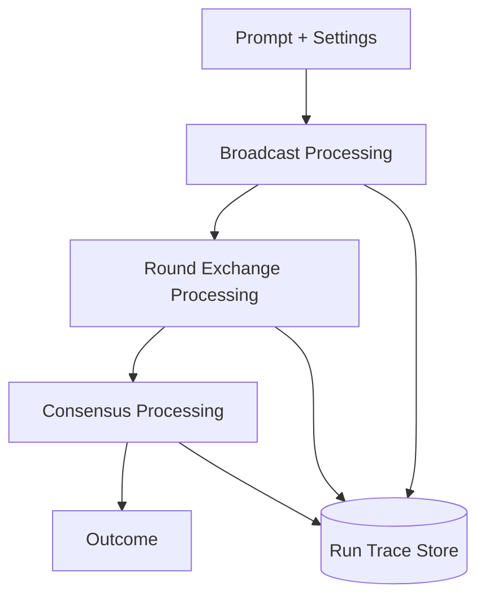
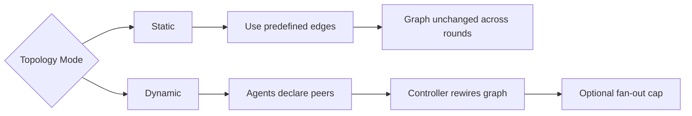
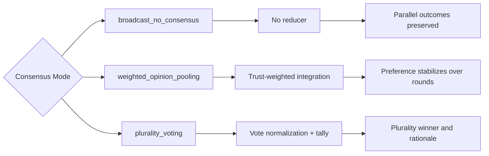
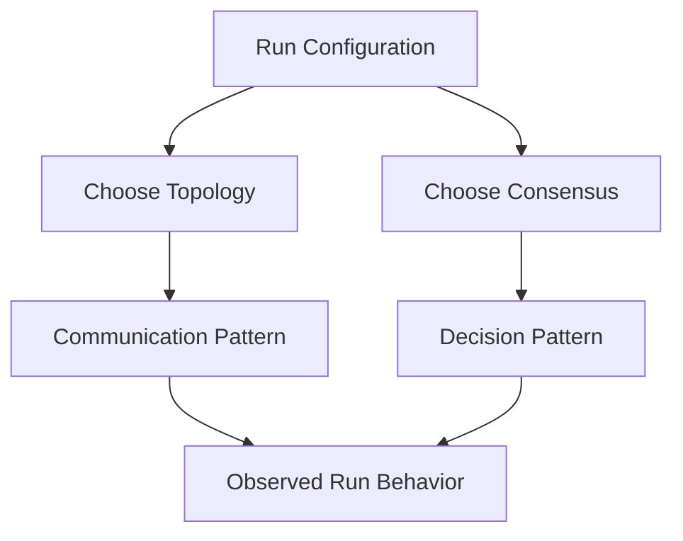
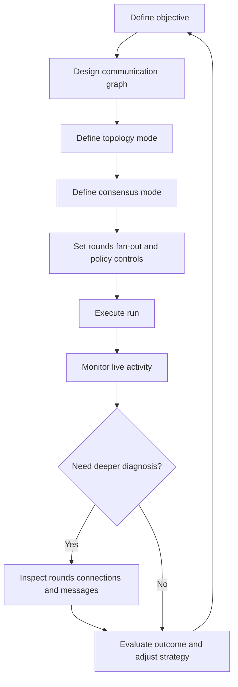

# Architecture Design: Multi-Agent Stochastic Self-Organisation

> This document is the architecture source of truth for product, engineering, and review stakeholders.

## 1) Scope and Audience

### Scope

This architecture covers:

- run orchestration from prompt to outcome
- topology behavior (static and dynamic)
- consensus behavior (all supported modes)
- persistence and replay boundaries
- user operating flow and governance checks

### Audience

- **Primary:** engineers and reviewers implementing or validating behavior
- **Secondary:** product and technical stakeholders evaluating system guarantees

### Out of scope

- low-level code organization
- framework-specific implementation details
- deployment vendor specifics

---

## 1A) Execution Engines & Code Boundaries

The system runs as a **modular monolith**: one FastAPI backend (`server/`) and one
frontend (`client/`). It exposes **two reasoning engines**, selected at runtime by the
`mode` field on `POST /api/simulation/run` — the user picks the mode in the UI. They are
in-process modules, **not** separately deployable services.

| Engine          | Mode value | Code                  | Behavior                                                                                                               |
| --------------- | ---------- | --------------------- | ---------------------------------------------------------------------------------------------------------------------- |
| **Topology**    | `topology` | `server/topology/`    | The V0 baseline documented in §7–§9 (topology + consensus). Read-only.                                                 |
| **Market-Hive** | `swarm`    | `server/market_hive/` | ECSAS: free-market bidding + append-only blackboard + citation-based consensus. See `docs/blackboard/PRD-ECSAS-v3.md`. |

Everything else is **shared platform**, used by both engines and owned by neither:

- `server/db/` — persistence: **PostgreSQL via SQLAlchemy Core** (asyncpg) in
  production/Docker, configured by `DATABASE_URL`; the test suite points the same Core
  schema at an in-memory SQLite database. Schema lives in `server/db/tables.py`.
- `server/llm/` — multi-provider model layer · `server/tools/` — tool abstraction &
  registry · `server/guardrails/` — input/output validation · `server/schemas/` — shared
  request/response models · `server/routes/` — the HTTP/SSE layer that dispatches on `mode`.

Design rule: domain logic lives in the two engine packages; shared infrastructure stays
flat under `server/`. There is no `common/` wrapper — `server.` is already the namespace.

---

## 2) Conceptual Architecture (L1)

This view answers: "What are the core system boundaries and who interacts with whom?"

Key idea: one system boundary, explicit external dependencies, clear ownership of orchestration.

---

## 3) Component Architecture (L2)

This view answers: "Which core modules exist and how they collaborate?"

Design rule: each component has one primary responsibility and a stable interface.

---

## 4) Deployment / Runtime Boundary View

This view answers: "Which runtime zones exist and what crosses boundaries?"

Non-negotiable boundary rule: all replay and observability comes from persisted history, not transient UI memory.

---

## 5) Sequence Diagram (Run Lifecycle)

This view answers: "In what order does execution happen?"

---

## 6) Data Flow Diagram (Execution Data Path)

This view answers: "How does information move and transform?"

Traceability rule: each transformation stage must emit a corresponding persisted artifact.

---

## 7) Topology Modes

Topology defines the communication graph used during round exchange.

- **Static topology** keeps the graph fixed for the run.
- **Dynamic topology** allows graph rewiring between rounds.

### 7.1 Static Topology

- **Purpose:** maximize predictability and comparability across runs.
- **Mechanics:** run uses predefined communication edges only; no rewiring occurs.
- **Result profile:** stable interaction structure and easier run-to-run comparison.

### 7.2 Dynamic Topology

- **Purpose:** enable adaptive, relevance-driven communication.
- **Mechanics:** agents declare peers each round, and the controller builds the next graph (with optional fan-out limits).
- **Result profile:** higher self-organization potential with increased structural variance.

| Dimension             | Static Topology       | Dynamic Topology                    |
| --------------------- | --------------------- | ----------------------------------- |
| Graph evolution       | fixed during run      | rewired between rounds              |
| Communication control | predefined links      | discovered links + selection policy |
| Predictability        | higher                | adaptive                            |
| Best fit              | controlled comparison | self-organization experiments       |

---

## 8) Consensus Modes

Consensus defines how distributed agent outputs are interpreted into an outcome signal.

### 8.1 broadcast_no_consensus

- **Purpose:** preserve the diversity of independent agent outcomes.
- **Mechanics:** no global reducer is applied after discussion rounds.
- **Result profile:** parallel outputs, suitable for exploration and analysis.

### 8.2 weighted_opinion_pooling

- **Purpose:** combine outputs through trust-sensitive weighting.
- **Mechanics:** weighted integration reflects evolving confidence/affinity signals.
- **Result profile:** stabilized weighted preference instead of hard-majority decisions.

### 8.3 plurality_voting

- **Purpose:** produce a clear single winner signal.
- **Mechanics:** normalized votes are tallied and resolved by plurality.
- **Result profile:** decisive output with explicit rationale trace.

| Consensus mode           | Core mechanism             | Decision signal                      |
| ------------------------ | -------------------------- | ------------------------------------ |
| broadcast_no_consensus   | no reducer                 | per-agent outputs remain independent |
| weighted_opinion_pooling | trust-weighted integration | stabilized weighted preference       |
| plurality_voting         | normalized vote tally      | plurality winner and reasons         |

---

## 9) Operating Mode Comparison (Topology x Consensus)

| Topology \ Consensus | broadcast_no_consensus                    | weighted_opinion_pooling                 | plurality_voting                        |
| -------------------- | ----------------------------------------- | ---------------------------------------- | --------------------------------------- |
| static               | stable discussion without final reducer   | stable graph with trust-weighted outcome | stable graph with majority-style winner |
| dynamic              | adaptive discussion without final reducer | adaptive graph + trust-weighted outcome  | adaptive graph + majority-style winner  |

---

## 10) User Flow

