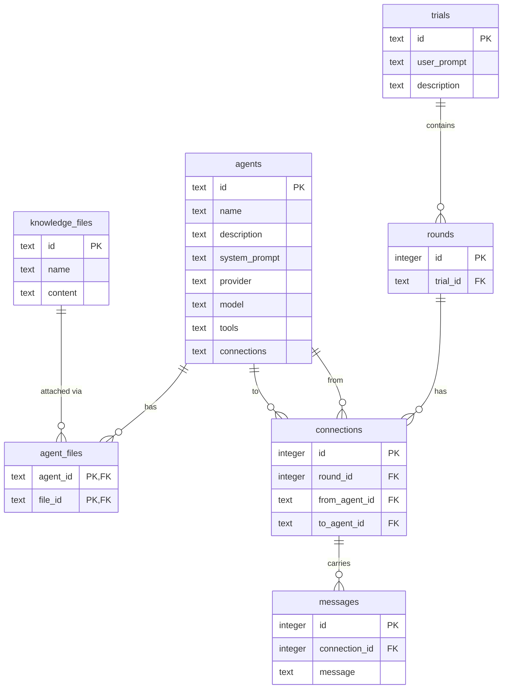

# Data Model

This document describes the persistent data model, the reasoning behind each table, and the relationships between them.

## Overview

The database models the execution history of a **Multi-Agent System (MAS)** forward pass. The hierarchy is linear:

```
Trial → Rounds → Connections → Messages
```

Agents are a separate, reusable concept that are referenced by connections but exist independently of any trial.

---

## Entity Relationship Diagram



## Table Descriptions

### `agents`

Defines the reusable participants of the MAS. An agent has a fixed identity (system prompt, LLM provider/model, available tools) that does not change between trials. Agents are referenced by connections but are not tied to any specific trial or round.

The `tools` column is a JSON array of tool-name strings. The `connections` column is a JSON array of agent IDs representing the default outgoing edges for this agent in the communication graph. Both are stored as `TEXT` so the application owns (de)serialisation.

### `knowledge_files`

Stores text documents that can be attached to agents as reference material. Each file has a `name` (used as a human-readable label and as the key when injecting files into a system prompt) and a `content` field holding the raw text.

### `agent_files`

Junction table linking agents to knowledge files. A file can be attached to multiple agents, and an agent can have multiple files. Rows are deleted automatically when either the parent agent or file is deleted (`ON DELETE CASCADE`).

### `trials`

A trial is a single end-to-end forward pass of the MAS: it starts with a `user_prompt` and ends when the system produces a final answer or reaches consensus. The `description` field is a short human-readable label (e.g. `"Run 3 – math task"`) useful for debugging and the UI.

### `rounds`

Within a trial, problem-solving is broken into discrete **rounds**. Each round represents one cycle of local agent work (tool calls, reasoning) followed by information sharing or voting between agents. Rounds are ordered by their auto-incremented `id` — a lower id means an earlier round.

### `connections`

A connection is a **directed edge** in the agent communication graph, scoped to a single round. Storing connections per-round rather than on the agent table is a deliberate design decision:

- The topology can be **pruned or rewired** between rounds (a core mechanism in stochastic self-organisation) without modifying the agent definitions.
- The full **history of every edge** that ever existed is preserved, which is essential for debugging and analysing how the system self-organised over time.
- The unique constraint `(round_id, from_agent_id, to_agent_id)` ensures no duplicate edges within a round.

### `messages`

A message stores the **payload transmitted along a connection** in a round. This could be:

- Output from a tool call
- A single agent's vote or score
- A reasoning summary or partial answer

Messages are intentionally schema-free (`TEXT`) to stay flexible as the communication protocol evolves.

---

## Design Decisions

| Decision                                                   | Rationale                                                                                                                                                                                                                         |
| ---------------------------------------------------------- | --------------------------------------------------------------------------------------------------------------------------------------------------------------------------------------------------------------------------------- |
| Connections are per-round, not per-agent                   | Enables topology changes (pruning/rewiring) across rounds while keeping full history                                                                                                                                              |
| `user_prompt` lives on `trial`                             | Trials are initiated by a user prompt; it is a first-class field, not metadata                                                                                                                                                    |
| `tools` stored as JSON in `agents`                         | Avoids a tools junction table for what is effectively a configuration list                                                                                                                                                        |
| PostgreSQL via SQLAlchemy Core                             | Persistent storage (Postgres in production/Docker; the test suite points the same code at in-memory SQLite via `conftest.py`). Schema is defined once in `server/db/tables.py` and created on startup — no migration tool needed. |
| Auto-increment integer PKs for rounds/connections/messages | Provides implicit chronological ordering at no extra cost                                                                                                                                                                         |
